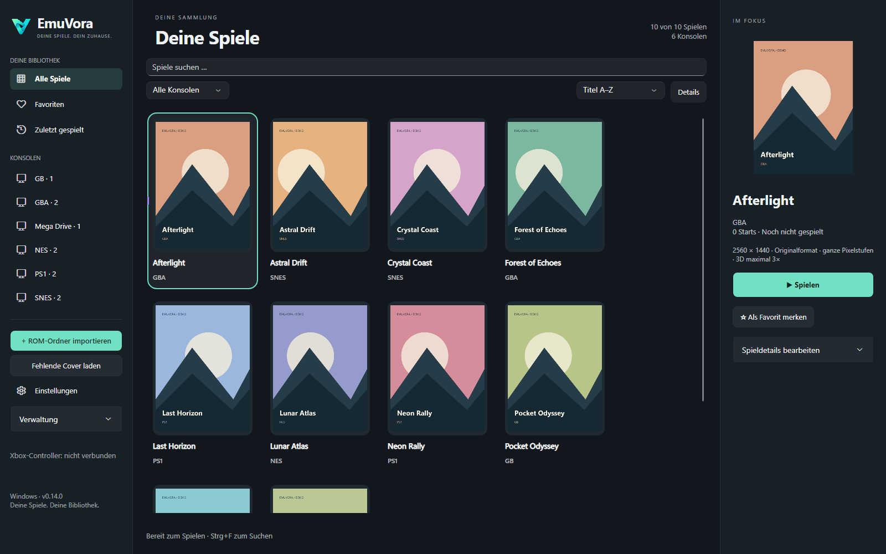
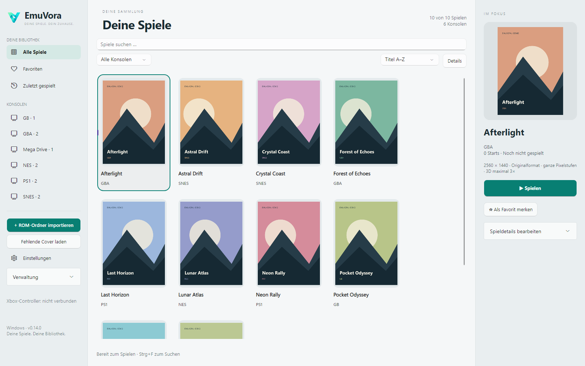

# EmuVora – Logo und Bibliotheksdesign

Stand: 20. Oktober 2026.

Das mintfarbene V mit Play-Aussparung ist das neue App-Zeichen. Die Wortmarke wird in der Oberfläche als Text gesetzt, damit sie auch bei Windows-Skalierung scharf bleibt. Das transparente PNG ist in der Anwendung eingebettet; das Windows-Icon enthält sieben Größen von 16 bis 256 Pixeln und wird für Programm, Setup und Verknüpfungen verwendet.

- Logo: [emuvora-mark.png](../src/EmuVora.App/Assets/emuvora-mark.png)
- Windows-Icon: [EmuVora.ico](../installer/EmuVora.ico)
- Icon neu verpacken: `./scripts/Build-BrandIcon.ps1` auf Windows.

## Oberfläche

Ruhige Navigation mit einheitlichen Windows-Symbolen, dynamischer Überschrift, klarer Such- und Filterleiste und hervorgehobener Spielauswahl. Die Detailspalte setzt Cover, Titel und Spielen-Aktion in eine feste Reihenfolge. Nicht vorhandene Cover erhalten systemabhängige Platzhalter; vorhandene Cover werden proportional dargestellt. Weitere Werkzeuge liegen unter **Verwaltung**, einschließlich Einrichtungsassistent, erneutem Scan und Systemübersicht.

Die vier Farbschemata und der TV-Modus bleiben verfügbar. Die Detailspalte wird unter 1120 Pixeln oder im TV-Modus ausgeblendet. Kleine Fenster behalten scrollbare Spiele- und Navigationsbereiche. Eine erfolglose Suche lässt sich direkt über **Filter zurücksetzen** aufheben. Der Kontrast des Spielen-Knopfs wird auch beim Darüberfahren mit der Maus automatisch geprüft (mindestens 4,5:1).

Die folgenden Aufnahmen zeigen die tatsächliche Avalonia-Oberfläche mit eigens erzeugten geometrischen **Demo-Covern und erfundenen Spielen**. Diese Testbilder werden nicht als Cover mitgeliefert. Sie sind keine Bildschirmfotos einer persönlichen Spielesammlung.

Veröffentlicht in **0.14.71**. Automatisierte Prüfung: 152 Funktionstests und 6 Netzwerktests im GitHub-Windows-Build bestanden; Setup, Update, Prozessübergabe und Datenerhalt geprüft. Der veröffentlichte EXE-Download wurde zusätzlich per EmuVora-Updater einschließlich SHA-256 überprüft. Neue Prüfungen betreffen Desktop/820-Pixel-Layout, eingebettete Marke, Icon, Kontrast, Filter-Rücksetzung und weiterhin erreichbare Verwaltung. Die bestehende Suite prüft alle vier Paletten, TV-Modus, Controller-Raster und Dialoge. Echte 4K-/DPI-/Controller-Hardwareabnahme bleibt Teil der Roadmap. Der GitHub-Build prüft zusätzlich offizielle Downloads und beide Installer.

## Logo-Erzeugung

Erstellt mit dem eingebauten **Imagegen**-Werkzeug, anschließend unverändert als transparentes PNG gespeichert. Das ICO-Verpackungsskript skaliert lediglich in Windows-Icon-Größen; die Oberfläche und ihre Symbole werden nativ gezeichnet.

Verwendeter Prompt:

> Use case: logo-brand. Asset type: production app icon for EmuVora, a premium personal retro-game library for Windows. Create ONE isolated bold geometric emblem, no text, no wordmark: a distinctive continuous angular ribbon forming a compact V with a subtle forward-play negative-space notch, evoking a portal into a games collection. Simple confident silhouette readable at 24 pixels. Flat vector-like shapes with immaculate edges, a restrained mint-to-turquoise gradient across the ribbon. No thin lines, no controller drawing, no console trademarks, no neon glow, no bevels, no shadows, no mockup, no border, no app tile background. Center the emblem, occupying 76 percent of a square canvas with generous clear space. Genuinely transparent background. Professional understated desktop software identity.

